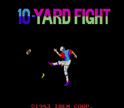
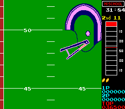

# 10-Yard Fight for MiSTer

## Overview

FPGA implementation of **10-Yard Fight**, originally released by Irem in 1983.

Current status: functional behavioural implementation, mainly based on MAME/reference behaviour and available hardware documentation.

Long-term goal: progressively improve the core through visual audits of schematic sheets and move it closer to a schematic-aligned implementation where possible.

The core implements the Irem M58 game board and M52 Large sound board.

Only the MAME parent set `10yard` (World, set 1) is supported.

## Screenshots

| | |
| --- | --- |
|  |  |

## Installation

1. Copy `releases/10YardFight_20261004.rbf` to `/_Arcade/cores/`.
2. Copy `releases/10-Yard Fight (World, set 1).mra` to `/_Arcade/`.
3. Supply your legally obtained `10yard.zip` in `/games/mame/` and launch the MRA.

**Important:** Move older 10-Yard Fight RBFs outside `/_Arcade/cores/` before installing this release to avoid loading the wrong version.

No ROMs are included. The MRA uses the `10yard` parent ROM set.

For additional information, see the [MiSTer Arcade ROM guide](https://github.com/MiSTer-devel/Main_MiSTer/wiki/Arcade-Roms).

## Controls and settings

Use the directional controls to move the player. Buttons 1 and 2 provide the game actions.

Coin adds credits, while Start 1P and Start 2P begin the corresponding game modes.

The MRA includes DIP switch settings for coinage, time reduction, screen flip, cabinet configuration, service mode and cheats.

The core OSD includes aspect ratio, service credit, Autosave High Scores, Save High Scores Now and Reset.

## High-score persistence

The core supports high-score saving through MiSTer's NVRAM system.

The NVRAM file is stored at:

`/media/fat/config/nvram/10-Yard Fight (World, set 1).nvm`

When Autosave High Scores is enabled, the core captures qualifying scores after initials entry and requests a save.

The **Save High Scores Now** option provides a manual save mechanism.

**Current verification status:** High-score qualification, initials entry and NVRAM file creation have been observed on hardware. Restoration of saved scores after reloading the core or power cycling has not yet been independently verified.

## Credits and licences

**GPL-3.0-or-later covers harlock74's original contributions only.**

Inherited material retains its own terms and notices.

| Component | Credits | Applicable terms / reference |
|---|---|---|
| M58 game/video and M52 sound implementation | harlock74; schematic and MAME references | Scoped [owner grant](LICENSE) |
| MiSTer integration and NVRAM support | harlock74; inherited MiSTer Template interfaces | Owner contributions under GPL-3.0-or-later; inherited framework terms retained |
| T80 Z80 CPU | Daniel Wallner, MikeJ, Sorgelig and contributors | Original source/synthesized-form conditions retained |
| CPU68 sound CPU | John E. Kent; Jared Boone and Gyorgy Szombathelyi credited in inherited sources | Original unversioned GNU public license notice retained; see [NOTICE.md](NOTICE.md) |
| YM2149 sound generators | MikeJ | Original source/synthesized-form conditions retained |
| MiSTer framework | MiSTer Template contributors, including Till Harbaum, Alexey Melnikov, Ludvig Strigeus, TEMLIB and Mike Simone | Retained component-specific GPL/LGPL and other notices |
| PLL and reconfiguration IP | Intel / Altera | Original vendor notices and device-use restrictions |

For complete third-party attribution, licensing details and source provenance, see [NOTICE.md](NOTICE.md), [LICENSE](LICENSE), the existing upstream-source documentation and the accompanying `LICENSES/` directory.

Game ROMs and other copyrighted game assets are not distributed.

## Building the core

The project targets the Cyclone V **5CSEBA6U23I7** FPGA and uses **Quartus Prime Lite 17.0.2 Build 602**.

Open `Arcade-10YardFight.qpf` in Quartus and select **Full Compilation**.

Alternatively, from the project directory, run:

`quartus_sh --flow compile Arcade-10YardFight -c Arcade-10YardFight`

Required source files, IP, constraints and generator scripts are included in the repository.

The supplied release RBF is the previously tested build. A newly compiled RBF should be tested independently before distribution.

**Release SHA-256:**

`10YardFight_20261004.rbf`

`93700528e841bf4115ff65988bfda1bcfe52aea9bfbe4be8048873faa7b92802`

**MRA SHA-256:**

`10-Yard Fight (World, set 1).mra`

`63fafbd5424da9219756338143618890490a0381170a751d3687a11a12a2c43b`